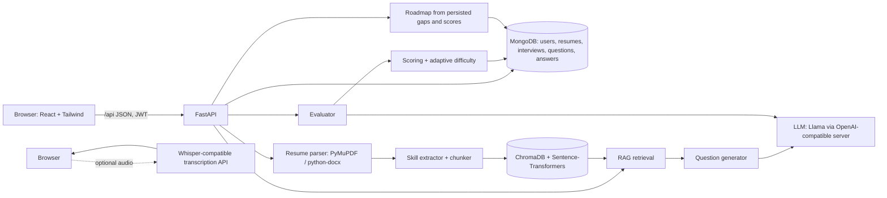

# Architecture (Phase 1)

Implemented in source but still requiring provider integration verification: optional browser audio recording can be sent to a separately configured Whisper-compatible transcription endpoint. The candidate can edit the transcript before submitting it as an answer. Audio is not retained by this app. OpenCV/MediaPipe visual measurements and a roadmap service remain unimplemented.

## Interview loop
1. `POST /api/interviews` → planner picks topic → RAG retrieves resume chunks → LLM writes question #1 (medium).
2. `POST /api/interviews/{id}/answer` → LLM scores 4 criteria → weighted overall → difficulty adjusted from the last 2 answers.
3. If the technical score is below 55 and the question was not itself a follow-up → one follow-up; otherwise next planned topic.
4. After N answers → summary (per-topic/criterion averages, strengths, weaknesses) stored on the interview.

## Design decisions (good viva answers)
- **Code decides coverage, LLM phrases questions** → predictable, no repeated topics, easy to test.
- **Strict JSON contract + validation + one retry** → malformed LLM output never reaches the database.
- **Vector store filtered by user_id and resume_id** → no cross-user retrieval.
- **Mock provider** → UI development without a GPU, but labelled so it can't be mistaken for AI evaluation.
